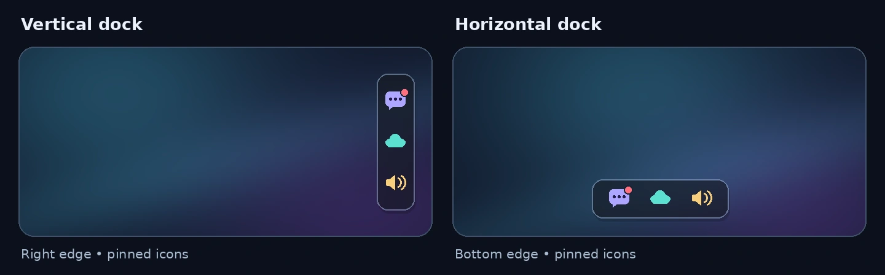

<h1 align="center">Floating Tray</h1>

<p align="center">Keep your Windows tray icons in view, even when the taskbar is hidden.</p>

<p align="center">
  <strong><a href="https://github.com/Mohmmadshabrani/Floating-Tray/releases/latest/download/Floating-Tray-Setup-x64.exe">Download for Windows</a></strong> ·
  <a href="#install">Install</a> ·
  <a href="#controls">Controls</a> ·
  <a href="#customize">Customize</a> ·
  <a href="#build-from-source">Build</a>
</p>

<p align="center">
  
</p>

<p align="center"><sub>Illustrated layouts on the primary display</sub></p>

Floating Tray is an always-on-top notification-area dock for **Windows 11 x64**, written in **Rust and Win32**. Pin the apps you want to keep an eye on, then leave the rest in the picker.

- **Live tray icons.** See status changes and unread badges when an app includes them in its tray icon.
- **Four edges.** Stack icons on the left or right, or line them up along the top or bottom.
- **A clear panel with fully visible icons.** Set the background to transparent or tint it to match your desktop.
- **Portable.** Extract and run the Windows build. The ZIP includes everything the dock needs.

## Install

On **Windows 11 x64**, exit any running copy of Floating Tray or YASB. Open `Floating-Tray-Setup-x64.exe`, choose **Install**, then launch Floating Tray from the Start menu. Setup installs for your Windows account without administrator access. [Download setup](https://github.com/Mohmmadshabrani/Floating-Tray/releases/latest/download/Floating-Tray-Setup-x64.exe)

For a portable copy, extract `Floating-Tray-Windows-x64.zip` and run `floating-tray.exe` with the included DLL beside it. The release page includes both options and their SHA-256 checksums. [Release downloads](https://github.com/Mohmmadshabrani/Floating-Tray/releases/latest)

Setup uses Inno Setup and is currently unsigned. Windows may display a SmartScreen prompt. You can compare the downloaded file’s SHA-256 hash against `SHA256SUMS.txt` on the release page.

## Controls

| To | Do this |
| --- | --- |
| Open the icon picker | Click **+**. After pinning an icon, click either blank end of the dock. |
| Pin or unpin an icon | **Alt+click** the icon. |
| Use an app’s tray icon | Click or right-click the icon. |
| Change the dock edge | Right-click **+** or a blank end and choose **Left**, **Top**, **Right**, or **Bottom**. |
| Refresh icons or exit | Right-click **+** or a blank end to open the dock menu. |

Your pins and edge placement are saved in `%LOCALAPPDATA%\FloatingTray\settings.txt`.

## Customize

Right-click **+** or either blank end and choose **Edit style**. This opens `%LOCALAPPDATA%\FloatingTray\style.ini` in Notepad. Save your changes, then choose **Reload style** from the same menu.

### Compact dark theme

```ini
background = #111319
border = #292E38
hover = #242938
icon_size = 16
icon_padding = 5
corner_radius = 8
opacity = 40
```

Use `opacity = 0` to clear the dock and picker panels. Icons and labels keep their original opacity, and the blank ends stay clickable. Use `opacity = 100` for a solid panel.

<details>
<summary>All style settings</summary>

| Settings | Controls |
| --- | --- |
| `background`, `border`, `hover` | Panel, outline, and hover colors in `#RRGGBB` |
| `text`, `muted_text` | Control and picker text colors in `#RRGGBB` |
| `icon_size`, `icon_padding` | Icon size and space around each icon |
| `padding`, `corner_radius` | Space inside the panel and corner rounding |
| `edge_margin`, `trigger_size` | Screen-edge gap and size of the clickable ends |
| `font_size` | Text size |
| `opacity` | Panel opacity from 0 (clear) to 100 (solid) |

Sizes are in pixels at 100% Windows scaling. See the [default style file](style.ini) for starting values.

</details>

## Tray icons and badges

Floating Tray mirrors Windows notification-area icons. Slack’s unread indicator appears when Slack includes it in its tray icon. Windows Notification Center handles toast history separately.

If an expected icon is missing, choose **Refresh icons** from the dock menu or reopen the app. Apps differ in how they register and update tray icons. If the pixels look soft, try a smaller `icon_size` such as `16`.

## Build from source

Use stable Rust and the Visual Studio **Desktop development with C++** toolchain on Windows x64. From the repository root:

```powershell
cargo test --locked
cargo build --release --locked
Copy-Item .\hook\YASBTrayHook.dll .\target\release\
.\target\release\floating-tray.exe
```

The workflow tests on Windows and Linux, runs a silent install and uninstall on Windows, and packages the wizard and portable ZIP. Push a version tag to publish. To rebuild or fill in missing downloads for an existing tag, run **Build and test** manually with that tag. [Build and test workflow](.github/workflows/build.yml)

## Credits and license

Floating Tray is [MIT licensed](LICENSE). It uses the native Explorer hook from **YASB v2.0.8** to receive icon updates. The Rust dock runs independently of the full YASB application. [YASB](https://github.com/amnweb/yasb) · [Hook source and license](hook/README.md)
